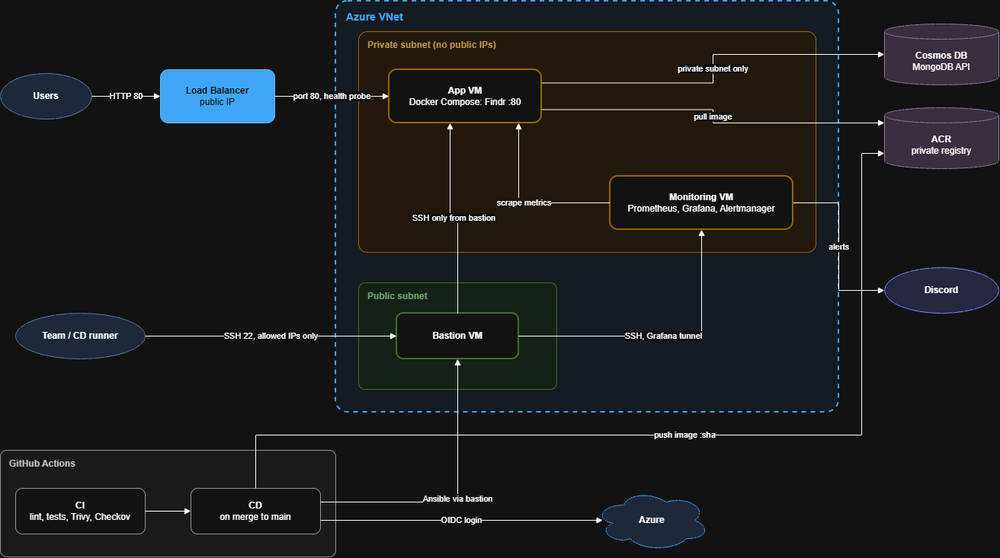
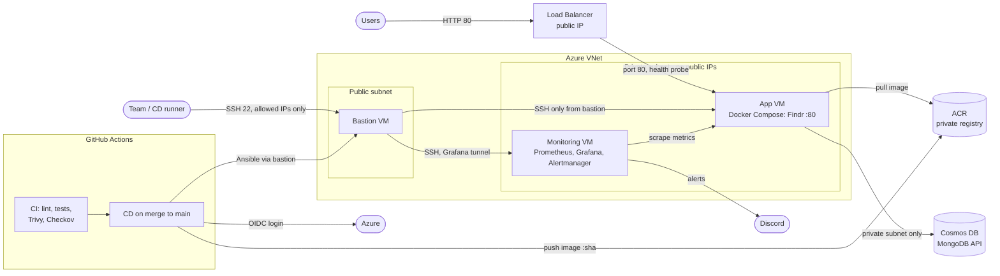

# Findr

> A simple lost and found app for the ALU campus, deployed to Azure with a fully automated Git-to-Production pipeline.

[](https://github.com/findr1/findr/actions/workflows/ci.yml)
[](https://github.com/findr1/findr/actions/workflows/cd.yml)
[](./LICENSE)

**Live app:** http://102.37.96.165 · **Demo video:** _coming soon_

<!--
  README OPERATIONS MANUAL (#128). Shina leads, everyone writes their own part.
  Find your name in a TODO comment like this one, write that section, then
  delete the comment. Keep it short and simple: link to the detailed READMEs
  (terraform/, ansible/, SECURITY.md) instead of repeating them.
-->

## Table of Contents

1. [About Findr](#about-findr)
2. [Team Members](#team-members)
3. [Live Application](#live-application)
4. [Architecture Overview](#architecture-overview)
5. [Technology Stack](#technology-stack)
6. [Repository Structure](#repository-structure)
7. [Setup Instructions](#setup-instructions)
8. [Run Locally](#run-locally)
9. [CI/CD Pipeline](#cicd-pipeline)
10. [Security Measures](#security-measures)
11. [Monitoring and Observability](#monitoring-and-observability)
12. [Challenges and Solutions](#challenges-and-solutions)
13. [Video Demo](#video-demo)
14. [Links](#links)
15. [License](#license)

## About Findr

On many African campuses, ALU included, lost and found happens in WhatsApp groups. Posts get buried within hours, old posts can't be searched, and nobody knows if an item was ever returned. A lost phone often means a lost mobile money wallet and SIM card.

Findr gives the campus one place to post and search lost and found items. It is built for phones, uses little data, and works with the tools students already use.

- **Report an item:** post a lost or found item with its category, place, date and contact, and share it to WhatsApp in one tap
- **Search and filter:** by name, place, status and category
- **Verified claims:** the finder sets a secret question, and their contact is shown only after the right answer
- **Mark as returned:** close a post once the item is back with its owner

## Team Members

| Name                 | Role                               | Built                                                                                                |
| -------------------- | ---------------------------------- | ---------------------------------------------------------------------------------------------------- |
| Gloire Gwiza         | Infrastructure (Terraform)         | Shared state, network, bastion, app VM, Load Balancer, firewalls, ACR                                |
| Bonae Ineza Gisubizo | Database, app and Azure setup      | Cosmos DB, `/api/ready`, GitHub-to-Azure login (OIDC), budget alert, metrics, Prometheus and Grafana |
| Norette Atete        | Configuration management (Ansible) | Deploy playbook through the bastion, Docker Compose deploy, monitoring role, architecture diagram    |
| Shina Atete Mpeta    | CI/CD and documentation            | CD pipeline, bastion firewall during deploys, smoke test, Discord alerts, this README                |

## Live Application

[**Open Findr**](http://102.37.96.165)

<!-- TODO(Shina): after the first green deploy, add a screenshot of the live app
     and the /api/ready response, e.g. docs/images/live-app.png -->

## Architecture Overview

### Architecture Diagram

<!-- TODO(Norette, #127): replace the Mermaid diagram below with the draw.io image:
      -->



### Component Description

<!-- TODO(Gloire): one or two lines per component (VNet and subnets, bastion,
     app VM, Load Balancer, NSGs, ACR, shared state) and how they connect.
     Details live in terraform/README.md, so link there. -->

<!-- TODO(Bonae): Cosmos DB (MongoDB API, free tier, private subnet only) and
     the monitoring VM. -->

### Security Controls at a Glance

<!-- TODO(Gloire): the firewall rules in plain words. Bastion: SSH only from
     allowed IPs. App VM: HTTP only from the Load Balancer, SSH only from the
     bastion. Cosmos DB: only the private subnet. Everything else denied. -->

## Technology Stack

- **Cloud provider:** Microsoft Azure (South Africa North)
- **Application:** Node.js 22 and Express 5 (API), React 19 and Vite (website)
- **Database:** Azure Cosmos DB for MongoDB (local development uses MongoDB in Docker)
- **Container registry:** Azure Container Registry (ACR)
- **Infrastructure as Code:** Terraform, with shared state in Azure Storage
- **Configuration management:** Ansible
- **CI/CD:** GitHub Actions
- **Security scanning:** Trivy (image), Checkov (Terraform), npm audit (packages)
- **Monitoring:** Prometheus, Grafana, Alertmanager (alerts to Discord)

## Repository Structure

```
findr/
├── .github/workflows/
│   ├── ci.yml               # CI on every PR: lint, tests, npm audit, Trivy, container check
│   ├── terraform-scan.yml   # Checkov scan of the Terraform code
│   └── cd.yml               # CD on merge to main: re-run CI, push to ACR, deploy with Ansible
├── terraform/               # Azure infrastructure (see terraform/README.md)
│   └── modules/             # network, security, compute, loadbalancer, registry, database
├── ansible/                 # Server setup and deploys (see ansible/README.md)
│   ├── deploy.yml           # Deploys Findr to the private app VM through the bastion
│   ├── monitoring.yml       # Installs the monitoring stack
│   └── roles/               # swap, docker, hardening, app_deploy, monitoring
├── monitoring/              # Prometheus, Grafana and Alertmanager config
├── backend/                 # API (Node.js + Express) and its tests
├── frontend/                # Website (React + Vite)
├── docs/                    # Architecture, branch protection, screenshots
├── Dockerfile               # One image with the website and the API
├── docker-compose.yml       # Runs the app and MongoDB together locally
├── SECURITY.md              # Scan results, fixes and accepted risks
└── CHANGELOG.md             # How Findr grew from Formative 1 to the Summative
```

## Setup Instructions

### Prerequisites

- An Azure subscription, and the [Azure CLI](https://learn.microsoft.com/cli/azure/install-azure-cli) logged in with `az login`
- [Terraform](https://developer.hashicorp.com/terraform/install) 1.5 or newer
- [Ansible](https://docs.ansible.com/ansible/latest/installation_guide/) (to deploy by hand; CD installs its own)
- An SSH key pair at `~/.ssh/findr` and `~/.ssh/findr.pub`
- A GitHub account with admin access to this repository (for secrets)

### Deployment Steps

1. **Clone the repository**

   ```bash
   git clone https://github.com/findr1/findr.git
   cd findr
   ```

2. **Provision the infrastructure with Terraform**
   <!-- TODO(Gloire): the short version: create the state storage once
        (bootstrap), copy terraform.tfvars.example, terraform init / plan /
        apply, and which outputs to note. Link terraform/README.md. -->

3. **Let GitHub Actions log in to Azure**
   <!-- TODO(Bonae): the managed identity findr-github-cd, its federated
        credential for main, and its roles. -->

4. **Add the GitHub secrets**
   <!-- TODO(Shina): table of every secret CD needs and where each comes from. -->

5. **Deploy**
   <!-- TODO(Shina): merge to main and CD does the rest. Also how to deploy by
        hand with Ansible (link ansible/README.md, Norette). -->

### Tearing Down

<!-- TODO(Gloire): terraform destroy, what it leaves behind on purpose (the
     state storage), and how to check nothing is left in the Azure portal. -->

## Run Locally

### With Node.js

Needs [Node.js](https://nodejs.org/) 22.9 or newer.

1. Start the API

   ```bash
   cd backend
   npm install
   cp .env.example .env    # set MONGODB_URI here to use MongoDB
   npm run dev
   ```

   The API runs at `http://localhost:3000`. Without `MONGODB_URI`, items are kept in memory and are lost when the server stops.

2. In a second terminal, start the website
   ```bash
   cd frontend
   npm install
   npm run dev
   ```
   The website runs at `http://localhost:5173`.

### With Docker Compose

Needs [Docker Desktop](https://www.docker.com/products/docker-desktop/) running. From the repository root:

```bash
docker compose up --build
```

This starts the **app** (website and API, built from the `Dockerfile`) and **db** (MongoDB, data kept in the `mongo-data` volume). Open `http://localhost:3000`.

```bash
docker compose down        # stop, keep the saved items
docker compose down -v     # stop and delete the saved items
```

The `Dockerfile` has three stages: build the website, install the API packages without test tools, then copy only what is needed into a small final image that runs as the `node` user with a health check on `/api/health`.

### API Endpoints

| Method  | Endpoint                  | What it does                                                                  |
| ------- | ------------------------- | ----------------------------------------------------------------------------- |
| `GET`   | `/api/health`             | The app is running                                                            |
| `GET`   | `/api/ready`              | The app and its database are both working                                     |
| `GET`   | `/api/items`              | List items (filter with `?status=lost&category=electronics&location=Library`) |
| `POST`  | `/api/items`              | Report a lost or found item                                                   |
| `GET`   | `/api/items/:id`          | Get one item                                                                  |
| `POST`  | `/api/items/:id/claim`    | Claim an item by answering its question                                       |
| `PATCH` | `/api/items/:id/returned` | Mark an item as returned                                                      |

## CI/CD Pipeline

### CI Pipeline

<!-- TODO(Shina): triggers, the jobs (lint and test, npm audit, Trivy,
     container check, Checkov), that each scan fails the build on HIGH or
     CRITICAL, and that all checks are required to merge
     (docs/branch-protection.md). -->

### CD Pipeline

<!-- TODO(Shina): trigger (merge to main only), the stages in order, the
     temporary bastion firewall rule, the smoke test, the Discord message,
     and how long a deploy takes. -->

## Security Measures

<!-- TODO(Shina): the scans and what they block, network security (private
     VMs, bastion, NSGs), secret management (GitHub secrets, OIDC with no
     stored cloud password, no admin user on ACR), and a link to SECURITY.md. -->

## Monitoring and Observability

<!-- TODO(Bonae): /api/health vs /api/ready, /metrics, the Grafana dashboard,
     the alert rules, and how to open Grafana through the bastion. -->

<!-- TODO(Shina): alerts go to the team's #findr-alerts Discord channel, and
     every deploy posts its result there too. -->

## Challenges and Solutions

<!-- TODO(everyone): one short entry each, in the form
     **Challenge:** ... **Solution:** ...
     Shina: reusing CI inside CD without the concurrency groups cancelling
     each other; opening SSH only during deploys. -->

## Video Demo

<!-- TODO(Shina): add the unlisted YouTube link once it is uploaded. -->

_Coming soon._

## Links

- [Project board](https://github.com/findr1/findr/projects)
- [CI and CD runs](https://github.com/findr1/findr/actions)
- [Branch protection rules](./docs/branch-protection.md)
- [Security scans and accepted risks](./SECURITY.md)
- [Terraform guide](./terraform/README.md) · [Ansible guide](./ansible/README.md)

## License

MIT License. See the [LICENSE](./LICENSE) file.
