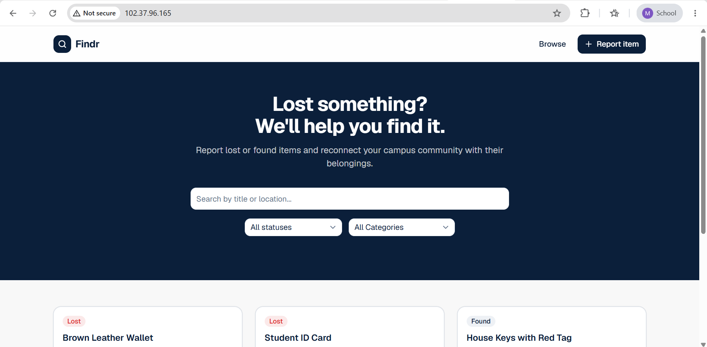
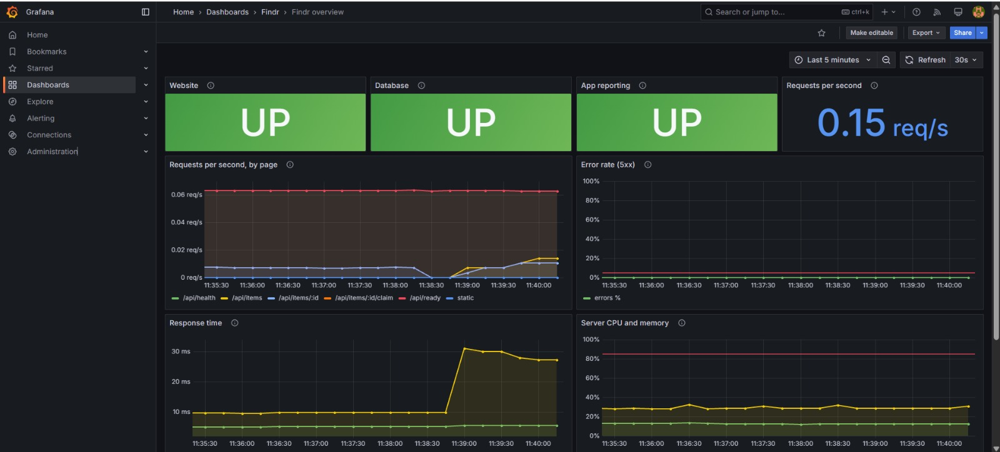
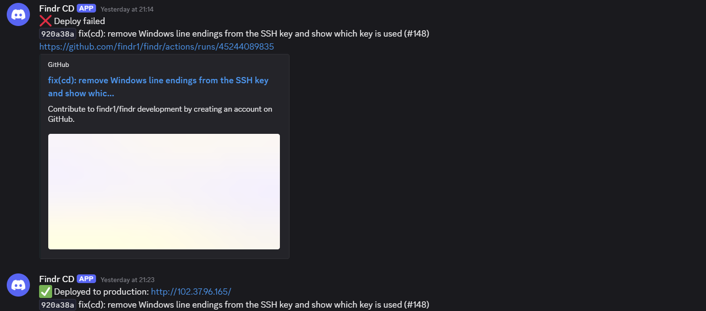

# Findr

> A simple lost and found app for the ALU campus, deployed to Azure with a fully automated Git-to-Production pipeline.

[](https://github.com/findr1/findr/actions/workflows/ci.yml)
[](https://github.com/findr1/findr/actions/workflows/cd.yml)
[](./LICENSE)

**Live app:** http://102.37.96.165 · **Demo video:** [Watch on YouTube](#video-demo) <!-- TODO(Shina): replace #video-demo with the unlisted YouTube link -->

## Table of Contents

1. [About Findr](#about-findr)
2. [Team Members](#team-members)
3. [Live Application](#live-application)
4. [Architecture Overview](#architecture-overview)
5. [Technology Stack](#technology-stack)
6. [Repository Structure](#repository-structure)
7. [Setup Instructions](#setup-instructions)
8. [Run Locally](#run-locally)
9. [CI/CD Pipeline](#cicd-pipeline)
10. [Security Measures](#security-measures)
11. [Monitoring and Observability](#monitoring-and-observability)
12. [Challenges and Solutions](#challenges-and-solutions)
13. [Video Demo](#video-demo)
14. [Links](#links)
15. [License](#license)

## About Findr

On many African campuses, ALU included, lost and found happens in WhatsApp groups. Posts get buried within hours, old posts can't be searched, and nobody knows if an item was ever returned. A lost phone often means a lost mobile money wallet and SIM card.

Findr gives the campus one place to post and search lost and found items. It is built for phones, uses little data, and works with the tools students already use.

- **Report an item:** post a lost or found item with its category, place, date and contact, and share it to WhatsApp in one tap
- **Search and filter:** by name, place, status and category
- **Verified claims:** the finder sets a secret question, and their contact is shown only after the right answer
- **Mark as returned:** close a post once the item is back with its owner

## Team Members

- Gloire Gwiza
- Bonae Ineza Gisubizo
- Norette Atete
- Shina Atete Mpeta

## Live Application

[**Open Findr**](http://102.37.96.165)



## Architecture Overview

### Architecture Diagram


### Component Description

Everything is built by Terraform in one resource group, `findr-dev-rg`, in South Africa North. Full details are in [terraform/README.md](terraform/README.md).

- **VNet (`10.0.0.0/16`)** with two subnets
  - **Public subnet (`10.0.1.0/24`):** only the bastion
  - **Private subnet (`10.0.2.0/24`):** the app VM and the monitoring VM. Nothing here has a public IP
- **Bastion VM:** the only server you can SSH to from the internet. The team and the CD pipeline reach the private VMs through it
- **App VM:** runs Findr with Docker Compose on port 80. Pulls its image from ACR with its own Azure identity, so no registry password
- **Load Balancer:** Findr's one public address. Sends port 80 to the app VM while `/api/health` answers, and gives the private VMs a way out to the internet
- **Firewalls (NSGs):** one for each subnet, see [Security Controls at a Glance](#security-controls-at-a-glance)
- **Container registry (ACR):** private, with the admin user turned off. CD pushes each image tagged with its commit SHA, and the app VM pulls it
- **Cosmos DB:** managed MongoDB (API 4.2) on the free tier (1000 RU/s and 25 GB free). Holds the `items` and `counters` collections. Only the private subnet can connect, through a VNet service endpoint. Azure backs it up every 4 hours, so the data survives app VM rebuilds
- **Monitoring VM:** runs Prometheus, Grafana, Alertmanager and blackbox_exporter. It is the only machine allowed to read the app VM's metrics. Grafana opens through the bastion
- **Shared state:** Terraform's state lives in Azure Storage (`findrtfstateafff2a46`), not on a laptop. You get in with `az login`, there are no storage keys, and the state locks while someone runs `plan` or `apply`

### Security Controls at a Glance

| Where               | What is allowed in                                                                                                                                                                                                               |
| ------------------- | -------------------------------------------------------------------------------------------------------------------------------------------------------------------------------------------------------------------------------- |
| **Bastion VM**      | SSH (22) only from the team's IPs (`allowed_ssh_cidrs`). During a deploy, CD adds a rule for the runner's IP and removes it when it finishes                                                                                     |
| **App VM**          | Port 80 from the internet, which can only arrive through the Load Balancer because the VM has no public IP. The Load Balancer's health check. SSH only from the bastion subnet. Metrics (9100, 9464) only from the monitoring VM |
| **Monitoring VM**   | Grafana (3000) and SSH only from the bastion subnet                                                                                                                                                                              |
| **Cosmos DB**       | Only the private subnet. The internet and our laptops are refused                                                                                                                                                                |
| **ACR**             | No admin password. The app VM can only pull (AcrPull), CD can only push (AcrPush)                                                                                                                                                |
| **Everything else** | Blocked by a `deny-all-inbound` rule on both firewalls                                                                                                                                                                           |

## Technology Stack

- **Cloud provider:** Microsoft Azure (South Africa North)
- **Application:** Node.js 22 and Express 5 (API), React 19 and Vite (website)
- **Database:** Azure Cosmos DB for MongoDB (local development uses MongoDB in Docker)
- **Container registry:** Azure Container Registry (ACR)
- **Infrastructure as Code:** Terraform, with shared state in Azure Storage
- **Configuration management:** Ansible
- **CI/CD:** GitHub Actions
- **Security scanning:** Trivy (image), Checkov (Terraform), npm audit (packages)
- **Monitoring:** Prometheus, Grafana, Alertmanager (alerts to Discord)

## Repository Structure

```
findr/
├── .github/workflows/
│   ├── ci.yml               # CI on every PR: lint, tests, npm audit, Trivy, container check
│   ├── terraform-scan.yml   # Terraform format, validate and Checkov scan
│   └── cd.yml               # CD on merge to main: re-run CI, push to ACR, deploy with Ansible
├── terraform/               # Azure infrastructure (see terraform/README.md)
│   └── modules/             # network, security, compute, loadbalancer, registry, database
├── ansible/                 # Server setup and deploys (see ansible/README.md)
│   ├── deploy.yml           # Deploys Findr to the private app VM through the bastion
│   ├── monitoring.yml       # Installs the monitoring stack
│   └── roles/               # swap, docker, hardening, app_deploy, monitoring
├── monitoring/              # Prometheus, Grafana and Alertmanager config
├── backend/                 # API (Node.js + Express) and its tests
├── frontend/                # Website (React + Vite)
├── docs/                    # Architecture, branch protection, screenshots
├── Dockerfile               # One image with the website and the API
├── docker-compose.yml       # Runs the app and MongoDB together locally
├── SECURITY.md              # Scan results, fixes and accepted risks
└── CHANGELOG.md             # How Findr grew from Formative 1 to the Summative
```

## Setup Instructions

### Prerequisites

- An Azure subscription, and the [Azure CLI](https://learn.microsoft.com/cli/azure/install-azure-cli) logged in with `az login`
- [Terraform](https://developer.hashicorp.com/terraform/install) 1.5 or newer
- [Ansible](https://docs.ansible.com/ansible/latest/installation_guide/) (to deploy by hand; CD installs its own)
- An SSH key pair at `~/.ssh/findr` and `~/.ssh/findr.pub`
- A GitHub account with admin access to this repository (for secrets)

### Deployment Steps

1. **Clone the repository**

   ```bash
   git clone https://github.com/findr1/findr.git
   cd findr
   ```

2. **Provision the infrastructure with Terraform**

   You need **Owner** on the subscription, or **Contributor** plus **Role Based Access Control Administrator**, because Terraform gives roles to the VMs and the CD pipeline. From the `terraform/` folder (PowerShell):

   ```powershell
   az login
   $env:ARM_SUBSCRIPTION_ID = (az account show --query id -o tsv)

   # Skip this line: the team already created the shared state storage.
   # Only run it when setting up the project in a new Azure subscription.
   powershell -ExecutionPolicy Bypass -File .\bootstrap\create-state-storage.ps1

   cp terraform.tfvars.example terraform.tfvars
   ```

   In `terraform.tfvars`, set `location` and put your IP in `allowed_ssh_cidrs` with `/32` at the end (find it at https://ifconfig.me). Then:

   ```powershell
   terraform init      # connects to the shared state
   terraform plan      # shows what will be built
   terraform apply     # builds it, type yes
   terraform output
   ```

   Note `app_url` (the site), `bastion_public_ip`, `ssh_bastion_command` and `ssh_app_command` (to log in), `grafana_tunnel_command` and `acr_login_server`. The full guide is in [terraform/README.md](terraform/README.md).

3. **Let GitHub Actions log in to Azure**

   CD logs in to Azure as the managed identity `findr-github-cd`, with OIDC. No cloud password is stored anywhere: a federated credential tells Azure to trust GitHub's short-lived tokens, but only from this repository's `main` branch. Create it once, in a resource group that `terraform destroy` doesn't delete (such as `findr-tfstate-rg`):

   ```powershell
   $rg = "findr-tfstate-rg"
   az identity create --name findr-github-cd --resource-group $rg

   az identity federated-credential create --name github-main `
     --identity-name findr-github-cd --resource-group $rg `
     --issuer https://token.actions.githubusercontent.com `
     --subject repo:findr1/findr:ref:refs/heads/main `
     --audiences api://AzureADTokenExchange

   # clientId goes in the AZURE_CLIENT_ID secret, principalId in cd_principal_id
   az identity show --name findr-github-cd --resource-group $rg --query "{clientId: clientId, principalId: principalId}"
   ```

   Put the `principalId` in `cd_principal_id` in `terraform.tfvars` and run `terraform apply` again. Terraform then gives the identity only what CD needs:

   | Role                | On                     | Why                                                    |
   | ------------------- | ---------------------- | ------------------------------------------------------ |
   | AcrPush             | The container registry | Push the new image                                     |
   | Reader              | `findr-dev-rg`         | Find the registry and the server addresses             |
   | Network Contributor | The bastion firewall   | Open SSH for the runner during a deploy, then close it |

   It also needs **Storage Blob Data Contributor** on the state storage, given once by hand (the command is in [terraform/README.md](terraform/README.md#give-a-teammate-access)).

4. **Add the GitHub secrets**

   In GitHub, go to **Settings → Secrets and variables → Actions → New repository secret** and add:

   | Secret                  | What it is                                                                 | Where to get it                                                                                                      |
   | ----------------------- | -------------------------------------------------------------------------- | -------------------------------------------------------------------------------------------------------------------- |
   | `AZURE_CLIENT_ID`       | The `findr-github-cd` identity                                             | `clientId` from the `az identity show` command in step 3                                                             |
   | `AZURE_TENANT_ID`       | Our Azure tenant                                                           | `az account show --query tenantId -o tsv`                                                                            |
   | `AZURE_SUBSCRIPTION_ID` | Our Azure subscription                                                     | `az account show --query id -o tsv`                                                                                  |
   | `SSH_PRIVATE_KEY`       | The private key the VMs were built with, so CD can SSH through the bastion | The whole private key file, with no passphrase                                                                       |
   | `MONGODB_URI`           | The Cosmos DB connection string                                            | `terraform output -raw mongodb_uri`                                                                                  |
   | `ADMIN_TOKEN`           | The password for the admin (moderation) routes                             | Any long random string you choose                                                                                    |
   | `DISCORD_WEBHOOK_URL`   | Where CD posts each deploy's result                                        | In Discord: **Edit Channel → Integrations → Webhooks → Copy Webhook URL**. Optional: without it CD skips the message |

5. **Deploy**

   Merge a pull request into `main`. The [CD pipeline](#cd-pipeline) checks the code, builds the image, deploys it and tests the live site. Nothing else is needed.

   To deploy by hand instead, run the Ansible playbook through the bastion. The steps and the environment variables it needs are in [ansible/README.md](ansible/README.md#deploying-to-azure-bastion-setup). The monitoring VM is set up the same way with `ansible-playbook monitoring.yml`.

### Tearing Down

The VMs and the Load Balancer use Azure credit every hour, even when nobody visits the site. To delete everything, from the `terraform/` folder:

```powershell
terraform destroy   # type yes
```

This deletes `findr-dev-rg` and everything in it: the VMs, Load Balancer, public IPs, firewalls, VNet, the registry and its images, and **Cosmos DB with all saved items**. `terraform apply` builds it all again when you need it.

It leaves two things on purpose, because Terraform doesn't manage them:

- **The state storage** (`findr-tfstate-rg`), so the team keeps its shared state
- **The `findr-github-cd` identity**, so CD can log in again after the next `apply`

To check nothing else is left, this should print nothing:

```powershell
az resource list --tag project=findr --output table
```

In the Azure portal, **Resource groups** should no longer list `findr-dev-rg`.

## Run Locally

### With Node.js

Needs [Node.js](https://nodejs.org/) 22.9 or newer.

1. Start the API

   ```bash
   cd backend
   npm install
   cp .env.example .env    # set MONGODB_URI here to use MongoDB
   npm run dev
   ```

   The API runs at `http://localhost:3000`. Without `MONGODB_URI`, items are kept in memory and are lost when the server stops.

2. In a second terminal, start the website
   ```bash
   cd frontend
   npm install
   npm run dev
   ```
   The website runs at `http://localhost:5173`.

### With Docker Compose

Needs [Docker Desktop](https://www.docker.com/products/docker-desktop/) running. From the repository root:

```bash
docker compose up --build
```

This starts the **app** (website and API, built from the `Dockerfile`) and **db** (MongoDB, data kept in the `mongo-data` volume). Open `http://localhost:3000`.

```bash
docker compose down        # stop, keep the saved items
docker compose down -v     # stop and delete the saved items
```

The `Dockerfile` has three stages: build the website, install the API packages without test tools, then copy only what is needed into a small final image that runs as the `node` user with a health check on `/api/health`.

### API Endpoints

| Method  | Endpoint                  | What it does                                                                  |
| ------- | ------------------------- | ----------------------------------------------------------------------------- |
| `GET`   | `/api/health`             | The app is running                                                            |
| `GET`   | `/api/ready`              | The app and its database are both working                                     |
| `GET`   | `/api/items`              | List items (filter with `?status=lost&category=electronics&location=Library`) |
| `POST`  | `/api/items`              | Report a lost or found item                                                   |
| `GET`   | `/api/items/:id`          | Get one item                                                                  |
| `POST`  | `/api/items/:id/claim`    | Claim an item by answering its question                                       |
| `PATCH` | `/api/items/:id/returned` | Mark an item as returned                                                      |

## CI/CD Pipeline

### CI Pipeline

**Runs on:** every push to a branch other than `main`, and every pull request into `main`. A new push cancels the run still going on the same branch.

| Job                                        | What it does                                                                                                                                              | Fails when                                                                        |
| ------------------------------------------ | --------------------------------------------------------------------------------------------------------------------------------------------------------- | --------------------------------------------------------------------------------- |
| **Lint and test (backend)**                | ESLint, then the Jest tests. Keeps the test results as an artifact                                                                                        | A lint error or a failing test                                                    |
| **Lint and test (frontend)**               | ESLint, then builds the website. Keeps the build as an artifact                                                                                           | A lint error or the build breaks                                                  |
| **Dependency scan** (backend and frontend) | `npm audit` on the packages                                                                                                                               | A HIGH or CRITICAL problem                                                        |
| **Image scan (Trivy)**                     | Builds the Docker image and scans it                                                                                                                      | A HIGH or CRITICAL problem that already has a fix                                 |
| **Docker build**                           | Builds the image and checks the container starts and `/api/health` answers. Only runs after the tests and both scans pass                                 | The container doesn't start                                                       |
| **Terraform format and validate**          | `terraform fmt -check`, then `terraform validate` on the whole configuration and its modules ([terraform-scan.yml](.github/workflows/terraform-scan.yml)) | A file isn't formatted, or the configuration has an error                         |
| **Terraform scan (Checkov)**               | Scans the Terraform code ([terraform-scan.yml](.github/workflows/terraform-scan.yml))                                                                     | Any failed check. Accepted findings are skipped in the code with a written reason |

Each scan keeps its full report as an artifact, even when it fails. Accepted findings and the reasons are in [SECURITY.md](SECURITY.md).

**All eight checks are required to merge**, and `main` only takes changes through a reviewed pull request. The rules are in [docs/branch-protection.md](docs/branch-protection.md).

### CD Pipeline

**Runs on:** a merge into `main` only, never on pull requests ([cd.yml](.github/workflows/cd.yml)). One deploy runs at a time. A new merge waits for the running deploy to finish instead of cancelling it halfway.

1. **Check again:** runs all of CI and the Terraform checks (format, validate, Checkov) on the merged code. Nothing is deployed unless every check passes
2. **Log in to Azure** with OIDC as `findr-github-cd`. No cloud password is stored
3. **Build and push** the image to ACR, tagged with the commit SHA, so every running version can be traced to its commit
4. **Open the bastion firewall** for this runner's IP only (a temporary rule at priority 110). The bastion is closed to the internet between deploys
5. **Deploy with Ansible** through the bastion: the app VM logs in to ACR with a short-lived token, pulls the new image and restarts with `docker compose up -d`
6. **Close the firewall.** This step runs even if the deploy failed or was cancelled, so the rule is never left open
7. **Smoke test** the live site through the Load Balancer, like a real user. `/api/ready` must answer and must be using the database (`"storage": "mongodb"`), or the deploy fails
8. **Tell the team** in Discord, whatever the result: deployed (with the link), checks failed, deploy failed, or cancelled. The message has the commit and a link to the run

A deploy takes about **8 to 10 minutes** from merge to the Discord message.

## Security Measures

### Scans

Four scans run on every pull request and again before every deploy. Each one blocks the merge when it fails:

| Scan            | What it checks                                   | Blocks on                                                  |
| --------------- | ------------------------------------------------ | ---------------------------------------------------------- |
| `npm audit`     | The backend and frontend packages                | HIGH or CRITICAL                                           |
| Trivy           | The Docker image (OS packages and Node packages) | HIGH or CRITICAL with a fix available                      |
| Checkov         | The Terraform code                               | Any failed check, unless skipped in the code with a reason |
| Container check | The image starts and `/api/health` answers       | Any failure                                                |

The Trivy action is pinned to a commit, not a tag, because its tags were hijacked in March 2026.

### Network Security

- The app and monitoring VMs have **no public IP**. Users only reach the app through the Load Balancer on port 80
- The **bastion** is the only way in for SSH. It accepts only the team's IPs, plus the CD runner's IP while a deploy is running
- **Firewalls (NSGs)** on both subnets allow only the traffic listed in [Security Controls at a Glance](#security-controls-at-a-glance) and block everything else
- **Cosmos DB** only accepts the private subnet. `/metrics` runs on its own port that only the monitoring VM can reach
- The Ansible `hardening` role turns off root login and password login over SSH, and adds fail2ban

### Secret Management

- **No secrets in git.** `.env` files, Terraform state and `.tfvars`, and private keys are all in `.gitignore`. Secrets live in GitHub Actions secrets
- **No stored cloud password.** CD logs in to Azure with OIDC, and Azure only trusts tokens from this repository's `main` branch
- **No registry password.** ACR has its admin user turned off. CD pushes with its Azure role (AcrPush), and the app VM pulls with a short-lived token
- **No storage keys.** The Terraform state storage has access keys turned off. People log in with `az login`
- The app runs as the `node` user, not root

The scan findings, accepted risks and how to report a problem are in [SECURITY.md](SECURITY.md).

## Monitoring and Observability

### Health Checks

| Endpoint      | What it checks                                                                         | Used by                                                 |
| ------------- | -------------------------------------------------------------------------------------- | ------------------------------------------------------- |
| `/api/health` | The app is running                                                                     | The Load Balancer health probe, the Docker health check |
| `/api/ready`  | The app is running **and** the database answers within 2 seconds. Returns `503` if not | The CD smoke test, Prometheus's website check           |

### Metrics

The app serves `/metrics` on its own port, **9464**, so it is never on the public website. The firewall lets only the monitoring VM reach it. Prometheus reads it every 15 seconds:

- `findr_http_requests_total`: requests answered, by page and status
- `findr_http_request_duration_seconds`: how long each request took
- `findr_db_up`: `1` if the database answers, `0` if not
- Node.js process metrics (memory, CPU, event loop), all starting with `findr_`

node_exporter (port 9100) adds the server's CPU, memory and disk. blackbox_exporter visits `/api/ready` like a user would.

### Grafana Dashboard

The **Findr overview** dashboard is loaded automatically. It shows whether the website, the database and the app are up, requests per second (in total and by page), the 5xx error rate, response time, server CPU and memory, and any alerts firing.

Grafana has no public address. Open it through the bastion, from the `terraform/` folder:

```powershell
terraform output -raw grafana_tunnel_command   # copy and run it, keep it open
```

Then open `http://localhost:3000`.



### Alert Rules

| Alert           | When                                               | Severity |
| --------------- | -------------------------------------------------- | -------- |
| SiteDown        | The public site hasn't answered for 2 minutes      | critical |
| AppNotReporting | Prometheus can't read `/metrics` for 2 minutes     | critical |
| DatabaseDown    | The app can't reach Cosmos DB for 1 minute         | critical |
| HighErrorRate   | Over 5% of requests are 5xx for 5 minutes          | warning  |
| SlowResponses   | 1 in 20 requests takes over 1 second for 5 minutes | warning  |
| HighCPU         | CPU above 85% for 10 minutes                       | warning  |
| HighMemory      | Memory above 90% for 10 minutes                    | warning  |
| DiskAlmostFull  | Under 10% disk left for 10 minutes                 | warning  |

The rules are in [monitoring/prometheus/alert-rules.yml](monitoring/prometheus/alert-rules.yml).

### Notifications

Alertmanager sends every alert to the team's `#findr-alerts` Discord channel as **Findr Alerts**, and posts again when the problem is fixed. Related alerts are grouped, and an alert that is still firing is repeated every 4 hours. The webhook URL is never in git: Alertmanager reads it from `monitoring/alertmanager/secrets/discord-webhook`, a file git ignores.

Every deploy also posts its result to the same channel as **Findr CD**, so the team sees both what was released and when something breaks. Below, a deploy of `920a38a` failed, and the next run of the same commit went live:



## Challenges and Solutions

| Challenge                                                                                                                                                                           | How we solved it                                                                                                                           |
| ----------------------------------------------------------------------------------------------------------------------------------------------------------------------------------- | ------------------------------------------------------------------------------------------------------------------------------------------ |
| **GitHub couldn't log in to Azure.** Student accounts can't create app registrations, and later the login failed because GitHub changed the format of the repository name it sends. | We used a managed identity with OIDC instead (no password), and added a second trust rule in the new format. It still only trusts `main`.  |
| **The pipeline's SSH key didn't work.** The secret first held the public key, then a cut-off private key, then one with Windows line endings.                                       | We saved the full private key. The pipeline now removes Windows line endings, checks the key, and prints its name (never the key itself).  |
| **Keeping the bastion closed.** The runner's IP changes on every run, and a new firewall rule takes a few seconds to work.                                                          | CD opens SSH for the runner's IP only, waits until the bastion answers, and always closes the rule at the end, even if the deploy fails.   |
| **The private VMs had no internet.** With no public IP, they couldn't download packages or pull images.                                                                             | The Load Balancer's outbound rule gives them a way out, without opening any way in.                                                        |
| **CI cancelled itself inside CD.** When CD reused the CI workflow, both runs shared one concurrency group and cancelled each other.                                                 | We gave each workflow a fixed concurrency group name.                                                                                      |
| **Empty registry address.** Azure printed the registry name and address on two lines, and the script only read the first.                                                           | We read both on one line, and the pipeline stops with a clear message if the address is empty.                                             |
| **Shared Terraform state.** An old local `terraform.tfvars` would have rebuilt both VMs, and an old branch tried to delete the database.                                            | We always pull `main` first and read the plan's "destroy" count before `apply`.                                                            |
| **Cosmos DB is not exactly MongoDB.** It needs an index for every sort and only allows unique indexes on empty collections.                                                         | Terraform creates the collections and indexes before any data is added. No app code changed.                                               |
| **Keeping metrics private.** `/metrics` must not be on the public website.                                                                                                          | The app serves it on its own port (9464), which only the monitoring VM can reach.                                                          |
| **Alerts didn't reach Discord.** They showed in Grafana but were still "pending", and no webhook was set.                                                                           | We documented pending vs firing and set the webhook outside the code.                                                                      |
| **The Trivy action was hijacked.** In March 2026, attackers took over its version tags to steal CI secrets.                                                                         | We pinned it to the commit of v0.35.0, the one release that wasn't affected, so its code can't change under us.                            |
| **npm audit flagged our dev tools.** The findings were in ESLint, Jest and the shadcn CLI, which never reach the live app, and shadcn was wrongly listed as an app dependency.      | We moved shadcn to devDependencies, and wrote up the low-severity findings as accepted risks, with reasons, in [SECURITY.md](SECURITY.md). |
| **Sharing secrets while debugging.** Keys and connection strings ended up in chat.                                                                                                  | Secrets now go only into GitHub secrets, and any leaked key is replaced.                                                                   |

## Video Demo

<!-- TODO(Shina): replace YOUTUBE_LINK below with the unlisted YouTube link, and the link in the line under the title. -->

**[Watch the Summative demo on YouTube](YOUTUBE_LINK)**

The video follows the 10 demo prompts in order, from the project board and branch protection (Formative 1) to a live deploy through the CD pipeline, monitoring, and our reflection.

## Links

- [Project board](https://github.com/findr1/findr/projects)
- [CI and CD runs](https://github.com/findr1/findr/actions)
- [Branch protection rules](./docs/branch-protection.md)
- [Security scans and accepted risks](./SECURITY.md)
- [Terraform guide](./terraform/README.md) · [Ansible guide](./ansible/README.md)

## License

MIT License. See the [LICENSE](./LICENSE) file.
