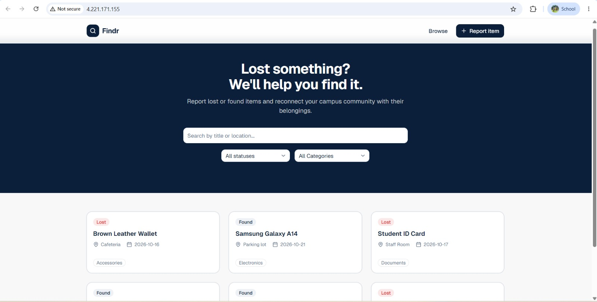

# Ansible

This folder sets up the server that Terraform creates, so that Findr runs on it. One command installs Docker, locks the server down, and starts the app with MongoDB. You can run it as many times as you like: a second run changes nothing.

## What's in this folder

| Path | What it is |
|------|------------|
| `ansible.cfg` | Settings: which inventory to use, and no SSH host-key prompt the first time we connect |
| `inventory/hosts.ini` | The server to set up, in the `web` group |
| `group_vars/web/vars.yml` | Settings for the `web` group: SSH user and key, app image and port, database name |
| `group_vars/web/vault.yml` | Secrets, encrypted with Ansible Vault: the database password and the GitHub registry login |
| `requirements.yml` | Ansible collections the roles need |
| `playbook.yml` | Runs the three roles on the `web` group |
| `roles/` | The steps, in three roles. See [What each role does](#what-each-role-does) |

## Prerequisites

Ansible doesn't run on Windows. Windows users run everything below in **WSL** (Ubuntu inside Windows).

1. **A server.** Bonae creates it with Terraform (see [`terraform/README.md`](../terraform/README.md)). You need its public IP.
2. **Ansible**, installed in Ubuntu or WSL:

   ```bash
   sudo apt update && sudo apt install -y pipx git
   pipx install --include-deps ansible
   pipx ensurepath   # then open a new terminal
   ```

3. **The group's SSH private key**, the pair of the public key Terraform put on the server. Put it in `~/.ssh/` inside WSL and make it readable only by you, or SSH will refuse to use it:

   ```bash
   cp /mnt/c/Users/<you>/Downloads/id_ed25519 ~/.ssh/id_ed25519
   chmod 600 ~/.ssh/id_ed25519
   ```

4. **The vault password**, shared privately by the team. Never commit it.

5. **The repository inside WSL.** Clone it into your WSL home folder. Don't run it from `/mnt/c/...`: Windows folders are open to every user, so Ansible ignores `ansible.cfg` there.

   ```bash
   cd ~ && git clone https://github.com/GLOIRE5/findr.git
   cd findr/ansible
   ```

6. **The collections** the roles need:

   ```bash
   ansible-galaxy collection install -r requirements.yml
   ```

## Inventory

The inventory tells Ansible which server to set up. Put the server's IP in [`inventory/hosts.ini`](inventory/hosts.ini):

```ini
[web]
findr-server ansible_host=<server public IP>
```

Bonae shares the IP after `terraform apply`. Anyone with the Terraform state can print it:

```bash
terraform -chdir=../terraform output -raw public_ip
```

Check that Ansible can reach the server:

```bash
ansible all -m ping
```

`findr-server | SUCCESS` with `"ping": "pong"` means the IP, user and key all work.

## Settings

Change these in [`group_vars/web/vars.yml`](group_vars/web/vars.yml):

| Setting | What it is |
|---------|------------|
| `ansible_user` | The user Ansible logs in as. It must match `admin_username` in Terraform (`azureuser`) |
| `ansible_ssh_private_key_file` | Path to the group's SSH private key |
| `findr_image` | The app image in GitHub Container Registry |
| `findr_image_tag` | Which version to deploy: the commit SHA of a pull request that CI built and pushed |
| `app_public_port` | The port people open in the browser. `80` matches the Terraform firewall. The app listens on `3000` inside its container |
| `mongo_user`, `mongo_db` | Database user and database name |

These secrets live in the encrypted [`group_vars/web/vault.yml`](group_vars/web/vault.yml):

| Secret | What it is |
|--------|------------|
| `vault_mongo_password` | MongoDB root password |
| `vault_ghcr_username`, `vault_ghcr_token` | Login for GitHub Container Registry. Leave the token empty if the image is public |

To view or change them:

```bash
ansible-vault edit group_vars/web/vault.yml
```

## Run the playbook

```bash
ansible-playbook playbook.yml --ask-vault-pass
```

To skip typing the vault password each time, save it in a `.vault_pass` file (git ignores it) and run:

```bash
chmod 600 .vault_pass
ansible-playbook playbook.yml --vault-password-file .vault_pass
```

A first run takes a few minutes. When it finishes, open `http://<server public IP>` in a browser and Findr loads.

### Check it's safe to run again

Run the same command a second time. Every task should come back `ok`, and the recap at the end should show **`changed=0`** and **`failed=0`**. That shows the playbook is idempotent: it only changes something when the server is different from what the playbook describes.

### Other useful commands

```bash
ansible-playbook playbook.yml --ask-vault-pass --check --diff   # show what would change, without changing it
ansible-playbook playbook.yml --ask-vault-pass --list-tasks     # list every task in order
```

`--check` works best once the server has been set up once, because some tasks depend on packages that earlier tasks install.

## What each role does

[`playbook.yml`](playbook.yml) runs three roles on the `web` group as root (`become: true`), in this order.

### 1. `docker`: install Docker

[`roles/docker`](roles/docker/tasks/main.yml)

- Adds Docker's official apt repository and its signing key.
- Installs Docker Engine, the Compose plugin, and `python3-docker`, which Ansible needs to manage containers.
- Starts Docker and turns it on at boot.
- Adds the login user to the `docker` group, so it can run `docker` without `sudo`.

### 2. `hardening`: lock the server down

[`roles/hardening`](roles/hardening/tasks/main.yml)

- **Firewall (UFW):** blocks all incoming traffic except SSH (22), HTTP (80) and HTTPS (443). SSH uses `limit`, which slows down anyone who connects too often. The open web ports are listed in [`defaults/main.yml`](roles/hardening/defaults/main.yml).
- **SSH:** turns off root login and password login, so only SSH keys work. It checks the new settings with `sshd -t` before restarting SSH, so a mistake can't lock us out.
- **fail2ban:** bans an IP for 1 hour after 5 failed logins in 10 minutes.
- SSH and fail2ban only restart when their settings change, through [handlers](roles/hardening/handlers/main.yml).

This sits behind the Azure firewall from Terraform, which already limits SSH to our IP. The two layers protect the server even if one of them is set up wrong.

### 3. `findr`: deploy the app

[`roles/findr`](roles/findr/tasks/main.yml)

- Logs in to GitHub Container Registry, only if a token is set. The login is hidden from the output (`no_log`).
- Creates a private Docker network, `findr-net`.
- Starts **MongoDB 7** (`findr-db`) on that network, with its data in the `findr-mongo-data` volume. It has no published port, so it can't be reached from the internet.
- Pulls the Findr image and starts it (`findr-app`), publishing port 80 to the app's port 3000. The database password comes from the vault.
- Both containers restart on their own after a crash or reboot (`unless-stopped`).
- Waits until the app answers on port 80, so the run only succeeds if Findr is really up.

## Tested on the real server

We ran the playbook on the Azure VM that Terraform created (`4.221.171.155`, Ubuntu). Findr opens at the server's public IP on port 80, with the app and MongoDB both running in Docker:



## Troubleshooting

| Problem | Fix |
|---------|-----|
| `UNREACHABLE` / `Permission denied (publickey)` | Check the IP in `hosts.ini`, check that the key in `vars.yml` pairs with the one Terraform used, and run `chmod 600` on the key |
| `Connection timed out` | The Terraform firewall only allows SSH from `my_ip_cidr`. If your IP changed, ask Bonae to update it and apply again |
| `[WARNING]: Ansible is being run in a world writable directory` | You're in `/mnt/c/...`. Clone the repo into your WSL home folder instead |
| `couldn't resolve module/action 'community.docker...'` | Run `ansible-galaxy collection install -r requirements.yml` |
| `Attempting to decrypt but no vault secrets found` | Add `--ask-vault-pass` |
| The app check times out | SSH in and run `docker logs findr-app`. Make sure `findr_image_tag` is a tag that exists in GHCR |

## Removing the app

Ansible doesn't delete anything. When testing is done, Bonae deletes the whole server with `terraform destroy` (see [`terraform/README.md`](../terraform/README.md)).
