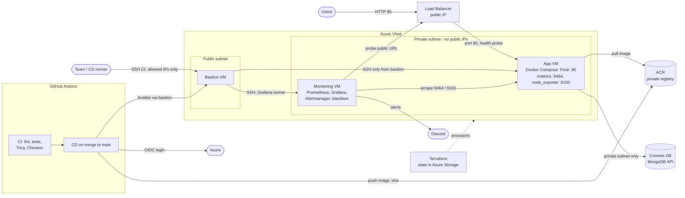

# Findr architecture (Azure)

**Firewall rules (NSGs):** bastion accepts SSH only from allowed IPs (the CD runner's IP is added during a deploy, then removed);
the app VM accepts HTTP only from the Load Balancer, SSH only from the bastion, and metrics only from the monitoring VM;
Cosmos DB accepts connections only from the private subnet. Everything else is denied.
